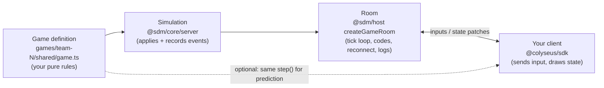
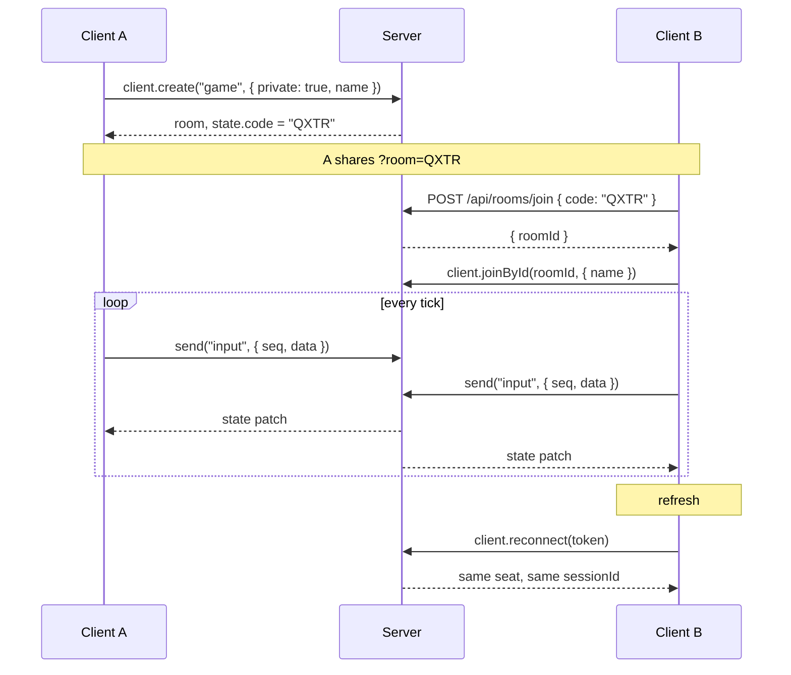
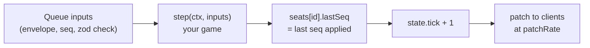
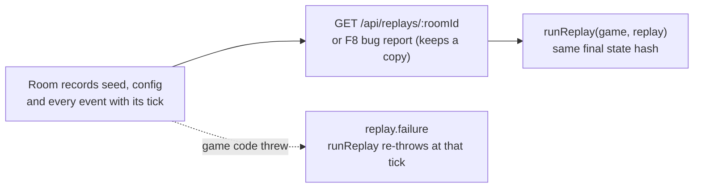

# Client guide: building a game on the room base

For frontend teams and their coding agents. Everything here applies to every game in `games/team-N/`. Working code to copy: `server/template/` (`shared/game.ts` is the game, `client/main.ts` is the client). Design and rationale: [design-docs/room-base.md](design-docs/room-base.md).

## The model

The server is the authority. Clients send **inputs** (what the player is pressing), never state. The room advances in fixed ticks, runs your game's `step`, and Colyseus sends the changed fields of the state to every client.



| Package | Import from | Use it for |
|---|---|---|
| `@sdm/core/shared` | client and server | Message names, routes, zod schemas (`InputEnvelopeSchema`, `BugReportSchema`, …) |
| `@sdm/core/sim` | client and server | `BaseState`, `RoomSettingsSchema`, `GameDefinition` types |
| `@sdm/core/client` | client | URL params, invite links, the server address for a game under a path, the `~` debug overlay with console and network stats, F8 bug reports, network simulation, interpolation, prediction (see [Client core](#client-core-sdmcoreclient)) |
| `@sdm/core/server` | server, tests | `Simulation`, `runReplay` |
| `@sdm/host` | server | `startGameServer`, `createGameRoom` |
| `@sdm/host/testing` | tests | `boot` for room tests |

## Connecting

```ts
import { Client } from "@colyseus/sdk";
import { serverUrlFromPage } from "@sdm/core/client";

// Locally the server runs on :2567 (Vite on :5173). Deployed, the server serves the client.
export const SERVER_URL =
  import.meta.env.VITE_SERVER_URL ??
  (import.meta.env.DEV ? "http://localhost:2567" : serverUrlFromPage(location.href));

const client = new Client(SERVER_URL);
```

### Your game lives under a path

In production every game is served under its own path, `<address>/team-N/`, behind the gateway (see [ARCHITECTURE.md](../ARCHITECTURE.md)). The gateway removes the prefix before the request reaches your server, so the server needs no change, but the client must not assume it sits at the root of the domain:

1. **Server address from the page.** Use `serverUrlFromPage(location.href)` from `@sdm/core/client`, never `location.origin` (it drops `/team-N`). On a page one folder below the server root (for example `multiplayer/index.html`), pass `1`: `serverUrlFromPage(location.href, 1)`.
2. **Relative assets.** Keep `base: "./"` in `vite.config.ts` (the template has it). With Vite's default `/`, the page asks for `/assets/...` and gets the gateway's 404 instead of your files.
3. **No absolute links.** Write `href="multiplayer/"` or `href="./multiplayer/"`, not `href="/multiplayer/"`, and ``fetch(`${SERVER_URL}/path`)``, not `fetch("/path")`. A link that starts with `/` leaves your game. The same goes for `new URL("/path", SERVER_URL)`: a leading `/` replaces the path of the base, so `https://host/team-2` becomes `https://host/path`. Build the address by joining strings, or use `serverLink(SERVER_URL, "/path")` from `@sdm/core/client`. End links to a folder with a slash (`multiplayer/`, not `multiplayer`): without it `express.static` redirects to `/multiplayer/` without the prefix, which leaves the game.
4. **Keep browser storage per game.** All games share one address, so `sessionStorage` and `localStorage` are shared too. Put the game's path in every key, as the template does (`sdm:${new URL(SERVER_URL).pathname}:reconnectionToken`), or a token or room code saved by `/team-2/` is tried on `/team-4/`.
5. **One page at `/`.** The game's page is served for every path that is not the API, so a deep link such as `/lobby/QXTR` loads `index.html`, whose relative assets then resolve under `/lobby/` and fail. Pass state in the query string (`/team-2/?room=QXTR`, as invite links do), not in the path. A second HTML page needs its own folder (`multiplayer/index.html`) and a trailing-slash link.

Check both ways: your game at the root of its own server, and behind the gateway at `/team-N/` (the local command is in the Gateway section of [ARCHITECTURE.md](../ARCHITECTURE.md)).

Room name: whatever your `room/index.ts` registers. The template registers `"game"`.

## A player's session



### Create a private room

```ts
const room = await client.create("game", { private: true, name: "Ada" });
// room.state.code is the 4-letter code (letters A–Z without I and O)
```

Without `private: true` the room is a quick-match room: `client.joinOrCreate("game", options)` finds it, and `state.code` is `""`.

### Join by code

Two calls: the HTTP route turns the code into a room id, then the SDK joins by id.

```ts
import { JoinByCodeResponseSchema, Routes } from "@sdm/core/shared";

const res = await fetch(`${SERVER_URL}${Routes.joinByCode}`, {
  method: "POST",
  headers: { "content-type": "application/json" },
  body: JSON.stringify({ code }), // case-insensitive
});
if (res.status === 404) /* unknown code */;
if (res.status === 409) /* room is full */;
const { roomId } = JoinByCodeResponseSchema.parse(await res.json());
const room = await client.joinById(roomId, { name: "Bo" });
```

Invite links: `buildInviteLink(location.href, code)` and `readClientParams(location.search).room` from `@sdm/core/client`.

Join options are checked by the game's `joinOptionsSchema`; invalid options reject the join with the zod message.

### Send input

```ts
let seq = 0;
room.send("input", { seq: ++seq, data: { dx: 1, dy: 0 } });
```

- `seq` goes up by one per input. The server drops an input whose `seq` is not higher than the last one it accepted from you.
- `data` must match your game's input schema, or it's dropped.
- Send **once per server tick** (`1000 / tickRate` ms), not every animation frame.
- While the room is paused, inputs are rejected, not saved up.

### Read state

`room.state` is a live Colyseus schema object. Draw from it every frame, or listen for changes. Every game's state has these fields from `BaseState`:

| Field | Meaning |
|---|---|
| `tick` | Simulation tick |
| `code` | Room code, `""` for quick-match rooms |
| `paused` | Set by the `pause` debug command |
| `seats` | Map keyed by sessionId: `{ connected, lastSeq }` |

Plus your game's own fields (the template has `players` and `pickups`). `seats[sessionId].lastSeq` is the last input seq the server applied for that player: a predicting client reconciles against it.

### Reconnect after a refresh

```ts
sessionStorage.setItem("token", room.reconnectionToken);
// on the next page load:
const room = await client.reconnect(sessionStorage.getItem("token"));
```

A dropped player's seat is held for `reconnectSeconds` (from `config/game.json`; the template uses 20). The player keeps their sessionId and state; `seats[id].connected` is `false` while they're away. After the window the seat is gone and `reconnect` throws: fall back to joining the saved code as a new player. Wrap `sessionStorage` in try/catch (it can throw in private windows).

### Server messages

| Message | Direction | Payload |
|---|---|---|
| `input` | client → server | `{ seq, data }` |
| `debug:command` | client → server | `{ id, command, args }`, rejected in production |
| `debug:result` | server → that client | `{ id, ok, output }` |
| `notice` | server → all | `{ level: "info" \| "warn" \| "error", text }`, e.g. "Server restarting", "The room hit an error and closed." |
| `debug:stats` | server → all, 1/s, not in production | `{ tick, tickMsAvg, tickMsP95, lateTicks }` |

Register a handler for every message you receive (`room.onMessage(type, fn)`), even ones you ignore. Constants: `ClientMessage` and `ServerMessage` in `@sdm/core/shared`.

## What happens each tick



Inputs that arrived since the last tick are applied together, in arrival order. `tickRate` and `patchRate` are set per game in `config/game.json`.

## Debug commands (outside production)

Sent as `debug:command`; the reply comes back as `debug:result`. Every command is recorded in the replay.

| Command | Effect |
|---|---|
| `pause` | Toggle pause |
| `step [n]` | While paused, advance n ticks (default 1, max 600) |
| `timescale x` | Run the tick loop x times faster or slower (0.1–10) |
| `seed n` | Reseed the room's random generator |
| `set path value` | Change a game config value, e.g. `set player.speed 300` (room settings can't change) |
| `kick playerId` | Remove a player |

Games add their own (the template has `spawn` and `tp id x y`). You don't need your own UI for them: type them into the console of the `~` overlay (see [Debug overlay and console](#debug-overlay-and-console)).

## Client core (`@sdm/core/client`)

Browser helpers every game can use, whatever draws it (Canvas, Phaser, Three.js): nothing in `@sdm/core/client` knows about a renderer, and the debug tools switch themselves off in production. `server/template/client/main.ts` uses all of them; copy from there.

### URL parameters and invite links

```ts
import { buildInviteLink, normalizeRoomCode, readClientParams, serverLink, serverUrlFromPage } from "@sdm/core/client";

const params = readClientParams(location.search);
// ?room=QXTR&name=Ada&scenario=crowded&debug → { room: "QXTR", name: "Ada", scenario: "crowded", debug: true }
normalizeRoomCode(" qxtr "); // "QXTR"; null when it isn't 4 letters from A–Z without I and O
buildInviteLink(location.href, "QXTR"); // the current page with only ?room=QXTR
serverUrlFromPage("https://host/team-2/?room=QXTR"); // "https://host/team-2": where the game's server is
serverLink("https://host/team-2", "/api/replays/r1"); // "https://host/team-2/api/replays/r1": a path below it, prefix kept
```

`params.room` is already checked with `normalizeRoomCode`, so an invalid code in a link comes back as `null`.

### Debug overlay and console

Press `~` to show the overlay: env, SHA, room, player, tick, ping, patches/s, bytes/s, fps and frame time, plus any lines your game adds. Its console sends the [debug commands](#debug-commands-outside-production) and shows the replies; ↑ and ↓ bring back earlier commands, and keys typed there never reach the game.

```ts
import { createDebugOverlay, createFrameMeter, trackRoomNetStats } from "@sdm/core/client";
import { ClientMessage, ServerMessage } from "@sdm/core/shared";

const overlay = createDebugOverlay({
  build: { env: health.env, sha: health.sha }, // from GET /health
  startOpen: params.debug,
  console: { send: (command) => room.send(ClientMessage.DebugCommand, command) },
});
room.onMessage(ServerMessage.DebugResult, (result) => overlay.handleDebugResult(result));

const frames = createFrameMeter(performance.now());
const net = trackRoomNetStats(room); // ping every 2 s, patches/s, bytes/s; call net.stop() on leave

function frame(now: number) {
  overlay.update(
    {
      roomId: room.roomId,
      roomCode: room.state.code || null,
      playerId: room.sessionId,
      tick: room.state.tick,
      ...net.read(now),
      ...frames.frame(now),
    },
    { pickups: room.state.pickups.size }, // optional game lines
    now,
  );
  requestAnimationFrame(frame);
}
```

`formatServerStats(stats)` turns the server's `debug:stats` message into one line (`1.2 / 4.6 ms (avg / p95), 2 late`) to pass as an extra line, as the template does. The parsing, history and reply log behind the console are exported too (`parseDebugCommand`, `createCommandHistory`, `createConsoleTranscript`) if you build your own console.

### F8 bug reports

Press F8, type one line, and the report (screenshot of the canvas, recent console output, env, SHA, room, player, tick and network simulation) is saved with `POST /api/bug-reports`; the server keeps the room's replay with it. The player then gets two links: the stored report, and a new GitHub issue pre-filled from the bug template.

```ts
import { createBugReporter, createLogBuffer } from "@sdm/core/client";

const logs = createLogBuffer();
logs.captureConsole(); // as early as possible, so the report has the lines before the bug

createBugReporter({
  serverUrl: SERVER_URL,
  issueRepo: "nd2003/sdm2026-1",
  teamLabel: "team-2", // your team
  logs,
  getCanvas: () => canvas,
  getContext: () => ({
    game: GAME_ID,
    build: { env: health.env, sha: health.sha },
    roomId: room.roomId,
    roomCode: room.state.code || null,
    playerId: room.sessionId,
    tick: room.state.tick,
    scenario: params.scenario,
    net: netConditions, // from readNetConditions, or null
    url: location.href,
    userAgent: navigator.userAgent,
  }),
});
```

The pieces work on their own too: `buildBugReport` (checked with `BugReportSchema`), `sendBugReport` (readable errors for 400, 413 and 429) and `buildIssueUrl`.

### Network simulation

Test how the game feels on a bad connection by adding lag, jitter and packet loss on your side. Turn it on from the URL: `?lag=150&jitter=30&loss=5` (milliseconds, milliseconds, percent).

```ts
import { createNetSimulator, NO_NET_CONDITIONS, readNetConditions } from "@sdm/core/client";

const netConditions = readNetConditions(location.search); // null when no ?lag/?jitter/?loss
const outgoing = createNetSimulator<InputEnvelope>(netConditions ?? NO_NET_CONDITIONS);

// Instead of sending right away:
outgoing.send({ seq, data: input }, performance.now());
// Every frame, send what is due:
for (const envelope of outgoing.drain(performance.now())) room.send(ClientMessage.Input, envelope);
```

Messages are never reordered, because a WebSocket never reorders them. Use a second simulator for incoming data, for example on the snapshots you push into an interpolation buffer. `setConditions()` changes the conditions while the game runs.

### Interpolation (other players)

The server sends patches a few times a second; drawing them as they arrive looks jumpy. An interpolation buffer draws other players slightly in the past, blending between two snapshots:

```ts
import { createInterpolationBuffer, lerpPoint, type Point } from "@sdm/core/client";

const others = createInterpolationBuffer<Point>({ delayMs: 100, lerp: lerpPoint }); // about 2 patches

room.onStateChange((state) => {
  const positions = new Map<string, Point>();
  for (const [id, p] of state.players.entries()) if (id !== room.sessionId) positions.set(id, { x: p.x, y: p.y });
  others.push(performance.now(), positions);
});

// Every frame:
for (const [id, pos] of others.sample(performance.now())) drawPlayer(id, pos.x, pos.y);
```

Push with the time the snapshot arrived and sample with the current time, on the same clock. Players who joined appear, players who left are dropped, and it never guesses ahead of the newest snapshot.

### Prediction (your own player)

Without prediction, your own player moves only after a round trip to the server. A predictor applies each input right away and corrects itself when the server's state arrives, using `seats[sessionId].lastSeq`:

```ts
import { createPredictor } from "@sdm/core/client";

const me = createPredictor<Point, SampleInput>({
  initial: { x: 0, y: 0 },
  apply: (pos, input) => moveOneTick(pos, input), // the same rule as your game's step(), from shared/
});

// When sending an input:
const { seq, state: predicted } = me.predict(input);
room.send(ClientMessage.Input, { seq, data: input });

// When the server's state arrives:
room.onStateChange((state) => {
  const player = state.players.get(room.sessionId);
  const seat = state.seats.get(room.sessionId);
  if (player && seat) me.reconcile({ x: player.x, y: player.y }, seat.lastSeq);
});

// Draw your player at me.state.
```

`predict` numbers inputs from 1, matching `lastSeq` starting at 0. The inputs the server hasn't applied yet are replayed on top of its state, so the server stays in charge but the player never waits.

### Small helpers

- `createFrameMeter(start)`: `frame(now)` returns `{ fps, frameMs }`.
- `addSample` / `ratePerSecond`: per-second counters over a sliding window of `RATE_WINDOW_MS` (one second).
- `createNetStatsMeter`, `messageSize`: the counting behind `trackRoomNetStats`, for rooms that don't look like a Colyseus room.
- `formatDebugLines(build, stats, extras)`: the overlay's text as lines, e.g. for logging it.
- `MAX_NAME_LENGTH`: the longest `?name=` that `readClientParams` keeps (24).

Every options object and result has an exported type with the same name (`DebugOverlayOptions`, `BugReporterOptions`, `BugReportContext`, `StatsRoomLike`, `PredictorOptions`, `InterpolationOptions`, …), so editors show what each field means.

## HTTP routes

| Route | Response |
|---|---|
| `GET /health` | `{ ok, env, sha, startedAt, games }` |
| `POST /api/rooms/join` | `{ code }` → `{ roomId }`; 404 unknown, 409 full |
| `GET /api/replays/:roomId` | The room's replay as a JSON download; 404 unknown; live rooms 10/min per IP |
| `POST /api/bug-reports` | `BugReport` → 201 `{ id, url }`; 400 invalid, 413 over 3 MB, 429 over 5/min per IP |
| `GET /api/bug-reports/:id` | `{ id, receivedAt, report, replay }` |
| `GET /api/stats` | `{ process, rooms }`; no room ids or codes in production |
| `/colyseus` | Colyseus monitor, not in production |

Request and response schemas are in `@sdm/core/shared`: import them, don't retype them.

Not using TypeScript, or giving the contract to a tool or agent? [`generated/api.schema.json`](generated/api.schema.json) is the same contract as JSON Schema: every HTTP route with its request and responses, every WebSocket message, and the replay format. It's generated from the zod schemas by `pnpm gen:api`, and `pnpm test` fails if it's out of date.

## Replays and bug reports



Replays of finished rooms stay in memory for an hour (50 rooms at most) and are lost on deploy. A bug report saves the room's replay when it's sent.

## Rules for game code (`shared/`)

- Randomness only from `ctx.rng`; never `Math.random()`.
- Time only from `ctx.dt` and `ctx.tick`; never `Date.now()`, `performance.now()` or timers.
- `shared/` imports only `@colyseus/schema`, `zod`, `@sdm/core/shared` and `@sdm/core/sim`, so the client can import it.
- State extends `BaseState`: `BaseState.extend({ ...yourFields }, "MyState")`. Don't write `tick`, `code`, `paused` or `seats`.
- Config extends `RoomSettingsSchema`; numbers live in `config/game.json`.
- Register rooms as factories in `room/index.ts`: `{ game: (deps) => createGameRoom(myGame, deps) }`.
- Room tests: `import { boot } from "@sdm/host/testing"`, then `boot(config)` without a port (it picks a free one).

Start a new game with `pnpm new-game team-N`. More rules: [../CLAUDE.md](../CLAUDE.md).

## Debugging a laggy playtest

Filter Railway logs by `@code:QXTR`, then read the room's `room.stats` lines (every 10 s):

| Field | High means |
|---|---|
| `tickMsP95`, `tickMsMax` | Slow game code |
| `lateTicks` | The server is overloaded |
| `inputsRejected` | A client bug (by reason: `envelope`, `schema`, `stale-seq`, `paused`) |
| `reconnects` | Flaky connections |

If the server's numbers are fine, it's the network: check ping in the `~` overlay. Errors: `@level:error` (each one carries the replay URL).
