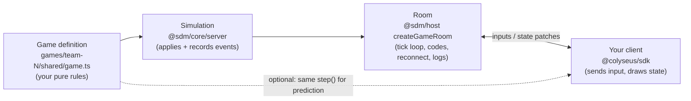
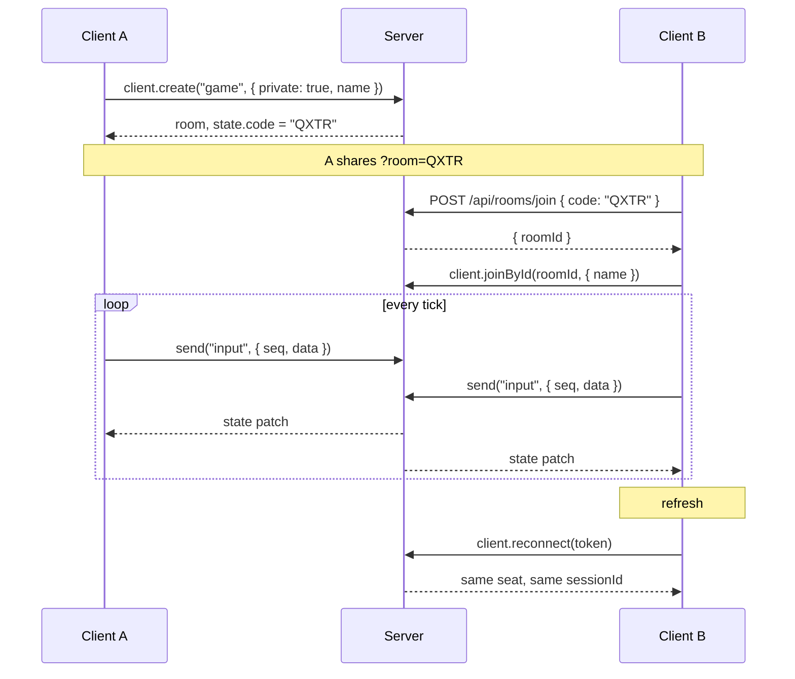
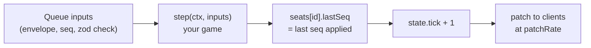
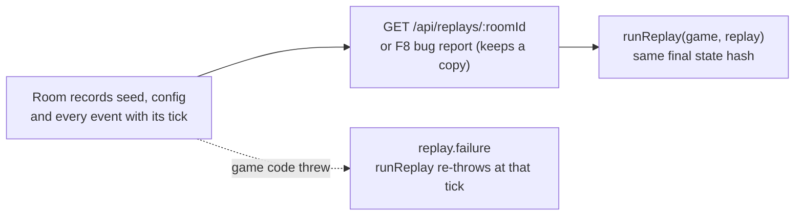

# Client guide: building a game on the room base

For frontend teams and their coding agents. Everything here applies to every game in `games/team-N/`. Working code to copy: `server/template/` (`shared/game.ts` is the game, `client/main.ts` is the client). Design and rationale: [design-docs/room-base.md](design-docs/room-base.md).

## The model

The server is the authority. Clients send **inputs** (what the player is pressing), never state. The room advances in fixed ticks, runs your game's `step`, and Colyseus sends the changed fields of the state to every client.



| Package | Import from | Use it for |
|---|---|---|
| `@sdm/core/shared` | client and server | Message names, routes, zod schemas (`InputEnvelopeSchema`, `BugReportSchema`, …) |
| `@sdm/core/sim` | client and server | `BaseState`, `RoomSettingsSchema`, `GameDefinition` types |
| `@sdm/core/client` | client | URL params (`readClientParams`), invite links, `~` debug overlay |
| `@sdm/core/server` | server, tests | `Simulation`, `runReplay` |
| `@sdm/host` | server | `startGameServer`, `createGameRoom` |
| `@sdm/host/testing` | tests | `boot` for room tests |

## Connecting

```ts
import { Client } from "@colyseus/sdk";

// Locally the server runs on :2567 (Vite on :5173). Deployed, the server serves the client.
export const SERVER_URL =
  import.meta.env.VITE_SERVER_URL ?? (import.meta.env.DEV ? "http://localhost:2567" : location.origin);

const client = new Client(SERVER_URL);
```

Room name: whatever your `room/index.ts` registers. The template registers `"game"`.

## A player's session



### Create a private room

```ts
const room = await client.create("game", { private: true, name: "Ada" });
// room.state.code is the 4-letter code (letters A–Z without I and O)
```

Without `private: true` the room is a quick-match room: `client.joinOrCreate("game", options)` finds it, and `state.code` is `""`.

### Join by code

Two calls: the HTTP route turns the code into a room id, then the SDK joins by id.

```ts
import { JoinByCodeResponseSchema, Routes } from "@sdm/core/shared";

const res = await fetch(`${SERVER_URL}${Routes.joinByCode}`, {
  method: "POST",
  headers: { "content-type": "application/json" },
  body: JSON.stringify({ code }), // case-insensitive
});
if (res.status === 404) /* unknown code */;
if (res.status === 409) /* room is full */;
const { roomId } = JoinByCodeResponseSchema.parse(await res.json());
const room = await client.joinById(roomId, { name: "Bo" });
```

Invite links: `buildInviteLink(location.href, code)` and `readClientParams(location.search).room` from `@sdm/core/client`.

Join options are checked by the game's `joinOptionsSchema`; invalid options reject the join with the zod message.

### Send input

```ts
let seq = 0;
room.send("input", { seq: ++seq, data: { dx: 1, dy: 0 } });
```

- `seq` goes up by one per input. The server drops an input whose `seq` is not higher than the last one it accepted from you.
- `data` must match your game's input schema, or it's dropped.
- Send **once per server tick** (`1000 / tickRate` ms), not every animation frame.
- While the room is paused, inputs are rejected, not saved up.

### Read state

`room.state` is a live Colyseus schema object. Draw from it every frame, or listen for changes. Every game's state has these fields from `BaseState`:

| Field | Meaning |
|---|---|
| `tick` | Simulation tick |
| `code` | Room code, `""` for quick-match rooms |
| `paused` | Set by the `pause` debug command |
| `seats` | Map keyed by sessionId: `{ connected, lastSeq }` |

Plus your game's own fields (the template has `players` and `pickups`). `seats[sessionId].lastSeq` is the last input seq the server applied for that player: a predicting client reconciles against it.

### Reconnect after a refresh

```ts
sessionStorage.setItem("token", room.reconnectionToken);
// on the next page load:
const room = await client.reconnect(sessionStorage.getItem("token"));
```

A dropped player's seat is held for `reconnectSeconds` (from `config/game.json`; the template uses 20). The player keeps their sessionId and state; `seats[id].connected` is `false` while they're away. After the window the seat is gone and `reconnect` throws: fall back to joining the saved code as a new player. Wrap `sessionStorage` in try/catch (it can throw in private windows).

### Server messages

| Message | Direction | Payload |
|---|---|---|
| `input` | client → server | `{ seq, data }` |
| `debug:command` | client → server | `{ id, command, args }`, rejected in production |
| `debug:result` | server → that client | `{ id, ok, output }` |
| `notice` | server → all | `{ level: "info" \| "warn" \| "error", text }`, e.g. "Server restarting", "The room hit an error and closed." |
| `debug:stats` | server → all, 1/s, not in production | `{ tick, tickMsAvg, tickMsP95, lateTicks }` |

Register a handler for every message you receive (`room.onMessage(type, fn)`), even ones you ignore. Constants: `ClientMessage` and `ServerMessage` in `@sdm/core/shared`.

## What happens each tick



Inputs that arrived since the last tick are applied together, in arrival order. `tickRate` and `patchRate` are set per game in `config/game.json`.

## Debug commands (outside production)

Sent as `debug:command`; the reply comes back as `debug:result`. Every command is recorded in the replay.

| Command | Effect |
|---|---|
| `pause` | Toggle pause |
| `step [n]` | While paused, advance n ticks (default 1, max 600) |
| `timescale x` | Run the tick loop x times faster or slower (0.1–10) |
| `seed n` | Reseed the room's random generator |
| `set path value` | Change a game config value, e.g. `set player.speed 300` (room settings can't change) |
| `kick playerId` | Remove a player |

Games add their own (the template has `spawn` and `tp id x y`).

## HTTP routes

| Route | Response |
|---|---|
| `GET /health` | `{ ok, env, sha, startedAt, games }` |
| `POST /api/rooms/join` | `{ code }` → `{ roomId }`; 404 unknown, 409 full |
| `GET /api/replays/:roomId` | The room's replay as a JSON download; 404 unknown; live rooms 10/min per IP |
| `POST /api/bug-reports` | `BugReport` → 201 `{ id, url }`; 400 invalid, 413 over 3 MB, 429 over 5/min per IP |
| `GET /api/bug-reports/:id` | `{ id, receivedAt, report, replay }` |
| `GET /api/stats` | `{ process, rooms }`; no room ids or codes in production |
| `/colyseus` | Colyseus monitor, not in production |

Request and response schemas are in `@sdm/core/shared`: import them, don't retype them.

Not using TypeScript, or giving the contract to a tool or agent? [`generated/api.schema.json`](generated/api.schema.json) is the same contract as JSON Schema: every HTTP route with its request and responses, every WebSocket message, and the replay format. It's generated from the zod schemas by `pnpm gen:api`, and `pnpm test` fails if it's out of date.

## Replays and bug reports



Replays of finished rooms stay in memory for an hour (50 rooms at most) and are lost on deploy. A bug report saves the room's replay when it's sent.

## Rules for game code (`shared/`)

- Randomness only from `ctx.rng`; never `Math.random()`.
- Time only from `ctx.dt` and `ctx.tick`; never `Date.now()`, `performance.now()` or timers.
- `shared/` imports only `@colyseus/schema`, `zod`, `@sdm/core/shared` and `@sdm/core/sim`, so the client can import it.
- State extends `BaseState`: `BaseState.extend({ ...yourFields }, "MyState")`. Don't write `tick`, `code`, `paused` or `seats`.
- Config extends `RoomSettingsSchema`; numbers live in `config/game.json`.
- Register rooms as factories in `room/index.ts`: `{ game: (deps) => createGameRoom(myGame, deps) }`.
- Room tests: `import { boot } from "@sdm/host/testing"`, each test file on its own port.

Start a new game with `pnpm new-game team-N`. More rules: [../CLAUDE.md](../CLAUDE.md).

## Debugging a laggy playtest

Filter Railway logs by `@code:QXTR`, then read the room's `room.stats` lines (every 10 s):

| Field | High means |
|---|---|
| `tickMsP95`, `tickMsMax` | Slow game code |
| `lateTicks` | The server is overloaded |
| `inputsRejected` | A client bug (by reason: `envelope`, `schema`, `stale-seq`, `paused`) |
| `reconnects` | Flaky connections |

If the server's numbers are fine, it's the network: check ping in the `~` overlay. Errors: `@level:error` (each one carries the replay URL).
